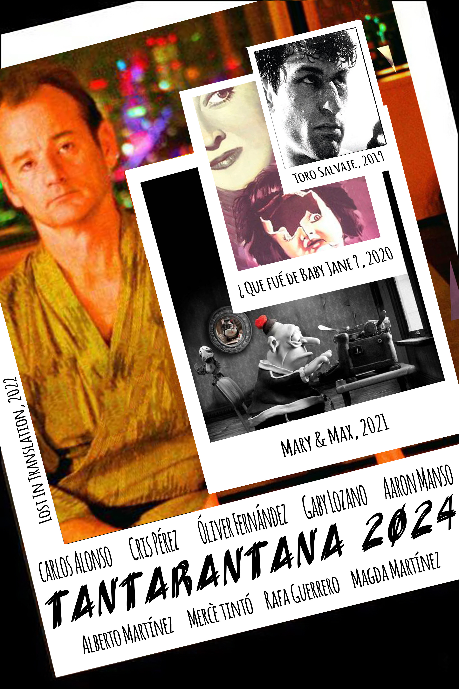

---
object-id: edition_2024
edition-id: edition_2024
name: 2024
label: XI Edición
description: |
  
  ¡Tantarantana cumple 10 años y hemos decidido celebrarlo por todo lo alto! Porque el cine no es sólo descubrimiento, entretenimiento y sorpresa… también es recuerdo, nostalgia, aprendizaje, experiencia… En esta edición veremos algunos de nuestros títulos favoritos, incluyendo las finalistas de las primeras nueve ediciones, pero también algunas de las películas que más marcaron nuestra infancia, aquellas que no podemos evitar ver una y otra vez, y otras que, por mucho que el tiempo pase y no hayamos vuelto a revisionar, jamás podremos olvidar. Porque el tiempo puede hacernos ver las películas con otros ojos, cambiar nuestras gustos y opiniones, hacernos experimentar diferentes sensaciones como parte del proceso de crecimiento y maduraración, pero jamás borrará nuestro amor incondicional por el cine…
presidents-id:
  - member_carlos
  - member_gaby
series:
  - serie-id: serie_2024_enero
  - serie-id: serie_2024_febrero
  - serie-id: serie_2024_marzo
  - serie-id: serie_2024_mayo
  - serie-id: serie_2024_junio
  - serie-id: serie_2024_julio
  - serie-id: serie_2024_september
  - serie-id: serie_2024_october
  - serie-id: serie_2024_november
  - serie-id: serie_2025_enero
  - serie-id: serie_2025_febrero
  - serie-id: serie_2025_marzo
  - serie-id: serie_2025_mayo
  - serie-id: serie_2025_junio
members:
  - member-id: member_carlos
  - member-id: member_oliver
  - member-id: member_rafa
  - member-id: member_gaby
  - member-id: member_alberto
  - member-id: member_magda
  - member-id: member_cristina
  - member-id: member_merce
awards:
  - award-id: award_best_movie
    winners:
      - movie-id: https://www.filmaffinity.com/es/film656153.html # La lista de Schindler
    finalists:
      - movie-id: https://www.filmaffinity.com/es/film594480.html # La vida es bella
      - movie-id: https://www.filmaffinity.com/es/film160882.html # Pulp Fiction
      - movie-id: https://www.filmaffinity.com/es/film564405.html # Antes del atardecer
      - movie-id: https://www.filmaffinity.com/es/film768790.html # El silencio de los corderos
      - movie-id: https://www.filmaffinity.com/es/film112475.html # El pianista
      - movie-id: https://www.filmaffinity.com/es/film587836.html # Lost in Translation
      - movie-id: https://www.filmaffinity.com/es/film428723.html # Volver
      - movie-id: https://www.filmaffinity.com/es/film230028.html # Slumdog Millionaire
      - movie-id: https://www.filmaffinity.com/es/film206955.html # Whiplash
  - award-id: award_best_director
    winners:
      - movie-id: https://www.filmaffinity.com/es/film656153.html # La lista de Schindler
        label: "Steven Spielberg"
        photo: https://image.tmdb.org/t/p/h632/tZxcg19YQ3e8fJ0pOs7hjlnmmr6.jpg
    finalists:
      - movie-id: https://www.filmaffinity.com/es/film230028.html # Slumdog Millionaire
        label: "Danny Boyle"
      - movie-id: https://www.filmaffinity.com/es/film701892.html # Apocalypse Now
        label: "Francis Ford Coppola"
      - movie-id: https://www.filmaffinity.com/es/film160882.html # Pulp Fiction
        label: "Quentin Tarantino"
      - movie-id: https://www.filmaffinity.com/es/film112475.html # El pianista
        label: "Roman Polanski"
      - movie-id: https://www.filmaffinity.com/es/film171099.html # 2001: Una odisea del espacio
        label: "Stanley Kubrick"
  - award-id: award_best_actor
    winners:
      - movie-id: https://www.filmaffinity.com/es/film396074.html # Taxi Driver
        label: "Robert De Niro"
        photo: https://image.tmdb.org/t/p/h632/cT8htcckIuyI1Lqwt1CvD02ynTh.jpg
    finalists:
      - movie-id: https://www.filmaffinity.com/es/film112475.html # El pianista
        label: "Adrien Brody"
      - movie-id: https://www.filmaffinity.com/es/film768790.html # El silencio de los corderos
        label: "Anthony Hopkins"
      - movie-id: https://www.filmaffinity.com/es/film598422.html # El resplandor
        label: "Jack Nicholson"
      - movie-id: https://www.filmaffinity.com/es/film520214.html # Joker
        label: "Joaquin Phoenix"
      - movie-id: https://www.filmaffinity.com/es/film656153.html # La lista de Schindler
        label: "Liam Neeson"
  - award-id: award_best_actress
    winners:
      - movie-id: https://www.filmaffinity.com/es/film564405.html # Antes del atardecer
        label: "Julie Delpy"
        photo: https://image.tmdb.org/t/p/h632/rd40f4QpAUUne3hMaUhHrZtcK2c.jpg
    finalists:
      - movie-id: https://www.filmaffinity.com/es/film167314.html # ¿Qué fue de Baby Jane?
        label: "Bette Davis"
      - movie-id: https://www.filmaffinity.com/es/film652266.html # Tres anuncios en las afueras
        label: "Frances McDormand"
      - movie-id: https://www.filmaffinity.com/es/film601157.html # El piano
        label: "Holly Hunter"
      - movie-id: https://www.filmaffinity.com/es/film131917.html # Melancolía
        label: "Kirsten Dunst"
      - movie-id: https://www.filmaffinity.com/es/film228749.html # La vida en rosa
        label: "Marion Cotillard"
      - movie-id: https://www.filmaffinity.com/es/film428723.html # Volver
        label: "Penélope Cruz"
  - award-id: award_best_ensemble
    winners:
      - movie-id: https://www.filmaffinity.com/es/film160882.html # Pulp Fiction
    finalists:
      - movie-id: https://www.filmaffinity.com/es/film964449.html # A propósito de Elly
      - movie-id: https://www.filmaffinity.com/es/film817968.html # El Gran Hotel Budapest
      - movie-id: https://www.filmaffinity.com/es/film809297.html # El padrino
      - movie-id: https://www.filmaffinity.com/es/film656153.html # La lista de Schindler
      - movie-id: https://www.filmaffinity.com/es/film121917.html # Mystic River
      - movie-id: https://www.filmaffinity.com/es/film428723.html # Volver
  - award-id: award_best_screenplay
    winners:
      - movie-id: https://www.filmaffinity.com/es/film563877.html # Mary and Max
    finalists:
      - movie-id: https://www.filmaffinity.com/es/film564405.html # Antes del atardecer
      - movie-id: https://www.filmaffinity.com/es/film889720.html # Her
      - movie-id: https://www.filmaffinity.com/es/film135623.html # Del revés (Inside Out)
      - movie-id: https://www.filmaffinity.com/es/film594480.html # La vida es bella
      - movie-id: https://www.filmaffinity.com/es/film291694.html # Nader y Simin, una separación
      - movie-id: https://www.filmaffinity.com/es/film160882.html # Pulp Fiction
  - award-id: award_best_editing
    winners:
      - movie-id: https://www.filmaffinity.com/es/film206955.html # Whiplash
    finalists:
      - movie-id: https://www.filmaffinity.com/es/film458406.html # Cisne negro
      - movie-id: https://www.filmaffinity.com/es/film656153.html # La lista de Schindler
      - movie-id: https://www.filmaffinity.com/es/film931317.html # Memento
      - movie-id: https://www.filmaffinity.com/es/film262430.html # Oldboy
      - movie-id: https://www.filmaffinity.com/es/film160882.html # Pulp Fiction
      - movie-id: https://www.filmaffinity.com/es/film230028.html # Slumdog Millionaire
  - award-id: award_best_soundtrack
    winners:
      - movie-id: https://www.filmaffinity.com/es/film151039.html # Amélie
      - movie-id: https://www.filmaffinity.com/es/film712041.html # Star Wars. Episodio IV
    finalists:
      - movie-id: https://www.filmaffinity.com/es/film420972.html # Cinema Paradiso
      - movie-id: https://www.filmaffinity.com/es/film627362.html # E.T. el extraterrestre
      - movie-id: https://www.filmaffinity.com/es/film809297.html # El padrino
      - movie-id: https://www.filmaffinity.com/es/film727297.html # En busca del arca perdida
  - award-id: award_best_photography
    winners:
      - movie-id: https://www.filmaffinity.com/es/film656153.html # La lista de Schindler
    finalists:
      - movie-id: https://www.filmaffinity.com/es/film171099.html # 2001: Una odisea del espacio
      - movie-id: https://www.filmaffinity.com/es/film151039.html # Amélie
      - movie-id: https://www.filmaffinity.com/es/film584711.html # Carol
      - movie-id: https://www.filmaffinity.com/es/film817968.html # El Gran Hotel Budapest
      - movie-id: https://www.filmaffinity.com/es/film598422.html # El resplandor
      - movie-id: https://www.filmaffinity.com/es/film230028.html # Slumdog Millionaire
  - award-id: award_best_sound
    winners:
      - movie-id: https://www.filmaffinity.com/es/film708792.html # Alien
    finalists:
      - movie-id: https://www.filmaffinity.com/es/film171099.html # 2001: Una odisea del espacio
      - movie-id: https://www.filmaffinity.com/es/film701892.html # Apocalypse Now
      - movie-id: https://www.filmaffinity.com/es/film832415.html # Drive
      - movie-id: https://www.filmaffinity.com/es/film712041.html # Star Wars. Episodio IV
      - movie-id: https://www.filmaffinity.com/es/film206955.html # Whiplash
  - award-id: award_best_art_direction
    winners:
      - movie-id: https://www.filmaffinity.com/es/film712041.html # Star Wars. Episodio IV
    finalists:
      - movie-id: https://www.filmaffinity.com/es/film171099.html # 2001: Una odisea del espacio
      - movie-id: https://www.filmaffinity.com/es/film817968.html # El Gran Hotel Budapest
      - movie-id: https://www.filmaffinity.com/es/film944222.html # El señor de los anillos: Las dos torres
      - movie-id: https://www.filmaffinity.com/es/film656153.html # La lista de Schindler
      - movie-id: https://www.filmaffinity.com/es/film745383.html # La naranja mecánica
      - movie-id: https://www.filmaffinity.com/es/film599419.html # Midsommar
  - award-id: award_best_costume_design
    winners:
      - movie-id: https://www.filmaffinity.com/es/film712041.html # Star Wars. Episodio IV
    finalists:
      - movie-id: https://www.filmaffinity.com/es/film307971.html # Cabaret
      - movie-id: https://www.filmaffinity.com/es/film817968.html # El Gran Hotel Budapest
      - movie-id: https://www.filmaffinity.com/es/film944222.html # El señor de los anillos: Las dos torres
      - movie-id: https://www.filmaffinity.com/es/film524439.html # Kill Bill. Volumen 1
      - movie-id: https://www.filmaffinity.com/es/film745383.html # La naranja mecánica
  - award-id: award_best_makeup
    winners:
      - movie-id: https://www.filmaffinity.com/es/film944222.html # El señor de los anillos: Las dos torres
    finalists:
      - movie-id: https://www.filmaffinity.com/es/film708792.html # Alien
      - movie-id: https://www.filmaffinity.com/es/film307971.html # Cabaret
      - movie-id: https://www.filmaffinity.com/es/film458406.html # Cisne negro
      - movie-id: https://www.filmaffinity.com/es/film809297.html # El padrino
      - movie-id: https://www.filmaffinity.com/es/film228749.html # La vida en rosa
  - award-id: award_best_special_effects
    winners:
      - movie-id: https://www.filmaffinity.com/es/film712041.html # Star Wars. Episodio IV
    finalists:
      - movie-id: https://www.filmaffinity.com/es/film171099.html # 2001: Una odisea del espacio
      - movie-id: https://www.filmaffinity.com/es/film708792.html # Alien
      - movie-id: https://www.filmaffinity.com/es/film974553.html # Big Fish
      - movie-id: https://www.filmaffinity.com/es/film627362.html # E.T. el extraterrestre
      - movie-id: https://www.filmaffinity.com/es/film727297.html # En busca del arca perdida
      - movie-id: https://www.filmaffinity.com/es/film944222.html # El señor de los anillos: Las dos torres
---